# EDA — deserción del tratamiento de fisura labiopalatina

**Frente 3** de `reports/auditoria.md` · Fecha: 2026-10-26 · Datos **sintéticos** · Sin entrenamiento de modelos.

Convención: **[H]** hecho comprobado · **[R]** resultado calculado · **[P]** hipótesis pendiente · **[Rec]** recomendación.

Entregables:

- `notebooks/03_eda.py` — script reproducible.
- `reports/figures/` — 12 figuras.
- `reports/eda_tables.md` — tablas completas generadas por el script.

Este documento describe los datos. **No elige el modelo, no ajusta umbrales y no afirma causalidad.** Esas decisiones pertenecen a los frentes 2, 4 y 5.

---

## Resumen ejecutivo

1. **v2 es la única cohorte utilizable para modelar.** v1 tiene 500 pacientes etiquetados, pero solo **30 no desertores**; no alcanza para entrenar ni evaluar. [R]
2. **La etiqueta está muy desbalanceada:** 71,4 % de deserción en v2 y 94,0 % en v1. Un clasificador que siempre diga “desertor” acierta 71,4 % en v2. [R]
3. **No hay fechas ni estructura longitudinal.** Una fila por paciente y ninguna columna de fecha de ingreso, cita, cirugía o cierre. No se puede hacer predicción temporal ni análisis de supervivencia. [H]
4. **Hay fuga de información confirmada.** `ratio_asistencia_terapia` separa las clases de forma perfecta en v2 (AUC = 0,000) y `citas_terapia_asistidas` tiene AUC = 0,030. Son acumulados de todo el tratamiento, no variables disponibles al predecir. [R]
5. **La etiqueta de v2 parece definida por la asistencia a terapia.** Si el ratio de asistencia separa perfectamente a desertores de no desertores, “predecir” con esa variable es tautológico. Esto debe discutirse con Fisulab antes de seguir. [P + Rec]
6. **El ETL actual introduce artefactos que identifican la cohorte:** `citas_asistidas` es constante 11 en v2, `cirugias_programadas` se estima con otra fórmula y `citas_asistidas_imputada` es equivalente a `cohorte`. [R]
7. **v1 y v2 no vienen de la misma distribución.** Las diferencias son grandes: no-show (SMD = 1,55), terapia asistida (SMD = 1,35), dificultad de alimentación preop. (SMD = −0,85) y peso Z (SMD = 0,67). Mezclarlas hace que el modelo aprenda la cohorte. [R]
8. **Hay una inconsistencia temporal grave:** 2.141 pacientes (61,2 %) tienen `edad_inicio_meses` posterior a `edad_queiloplastia_meses`. La definición de “inicio” no es clara. [R + P]
9. **Las features T1 de habla concentran una señal sospechosa:** la tasa de deserción va de 20,6 % en hipernasalidad grado 0 a 94,5 % en grado 3; IVF pasa de 67,1 % a 80,1 %. El frente 4 debe reportar T1 con y sin estas variables. [R + P]
10. **Faltan variables clave** para un modelo clínicamente útil: fechas de citas, motivo de cierre, barreras, transporte, tiempo de desplazamiento, satisfacción, motivación y apoyo familiar. [H]

---

## 1. Alcance y método

- Fuente: `data/processed/dataset_final_limpio.csv` (3.500 filas, una por paciente), generado por el ETL de los seis CSV de `data/raw/`. [H]
- Población: v2 (3.000) para el análisis orientado a modelado; v1 (500 etiquetados) solo como comparación descriptiva; los 500 v1 sin etiqueta se excluyen. [H]
- Features: se importan `FEATURES_T0`, `FEATURES_T1`, `EXCLUDED_LEAKAGE`, `select_features` y `select_target` desde `modeling_features.py`. `select_features` valida el contrato T0/T1 al cargar los datos y no se redefinen listas. [H]
- No se imputa, no se entrena, no se divide train/test y no se eligen umbrales. [H]
- Los archivos raw se usan para verificar disponibilidad de columnas y ausencias; el CSV procesado se usa para las features ya armonizadas. [H]
- Los datos son sintéticos. Todos los hallazgos son del ejercicio académico y no se extrapolan a pacientes reales. [H]

Reproducción:

```powershell
.\.venv\Scripts\python.exe notebooks/03_eda.py
```

El script escribe las figuras en `reports/figures/` y las tablas en `reports/eda_tables.md`. No modifica `data/`, `src/` ni `model.joblib`.

---

## 2. Calidad y estructura

| Chequeo | Resultado | Lectura |
|---|---|---|
| Pacientes | 3.500 | v1 = 500, v2 = 3.000 |
| IDs únicos / duplicados | 3.500 / 0 | Una fila por paciente |
| Solapamiento v1–v2 | 0 | Cohortes independientes |
| v1 sin etiqueta | 500 | Excluidos del modelado |
| Nulos en raw | 0 | Los seis CSV vienen completos |
| Nulos en procesado | 0 | 0 por construcción: el ETL imputó |
| Columnas de fecha | 0 | Sin ingreso, citas, cirugías ni cierre |
| Estructura longitudinal | Una fila por paciente | Sin historial de citas ni etapas |
| Etiqueta | 0/1 | Sin fecha ni motivo de cierre |

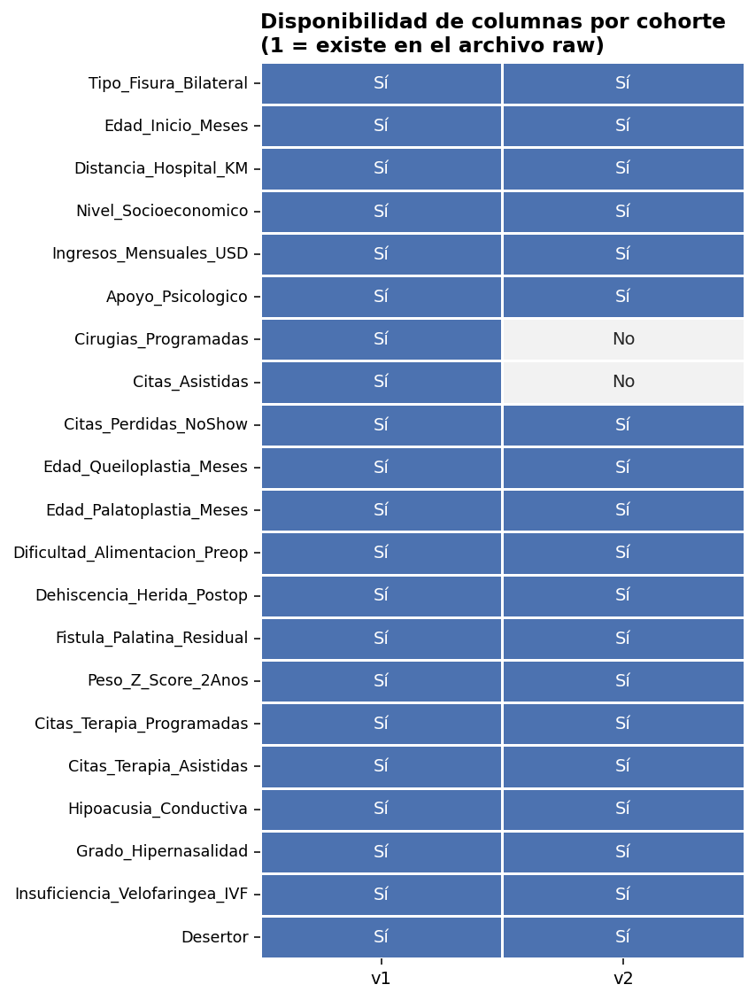

**Disponibilidad [H]:**

- v2 **no tiene** `Cirugias_Programadas` ni `Citas_Asistidas`.
- El ETL inventa `citas_asistidas = 11` para los 3.000 pacientes de v2 y estima `cirugias_programadas` con una fórmula distinta.
- `Citas_Perdidas_NoShow`, `Citas_Terapia_Asistidas`, `Citas_Terapia_Programadas`, `Grado_Hipernasalidad` y `Peso_Z_Score_2Anos` existen en ambas cohortes, pero con distribuciones distintas.

**Consecuencia:** cualquier análisis que use las columnas inventadas está midiendo la cohorte, no al paciente. [Rec: frente 2]

### Inconsistencia de edad

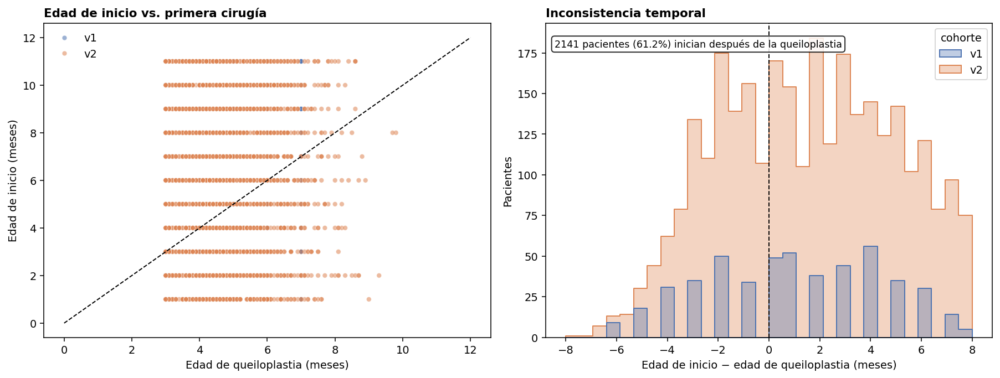

- **2.141 de 3.500 pacientes (61,2 %)** tienen `edad_inicio_meses` mayor que `edad_queiloplastia_meses`. [R]
- En v2, la mediana de inicio es 6 meses y la de queiloplastia 4,5 meses. [R]
- No hay `intervalo_cirugias_meses` negativo: la palatoplastia siempre es posterior a la queiloplastia. [R]

**Interpretación [P]:** o “inicio” no significa inicio del tratamiento global, o las edades se generaron con reglas distintas. Es una pregunta obligatoria para Fisulab. Mientras no se aclare, `edad_inicio_meses` no debería interpretarse como una variable clínica limpia.

---

## 3. Población y etiqueta

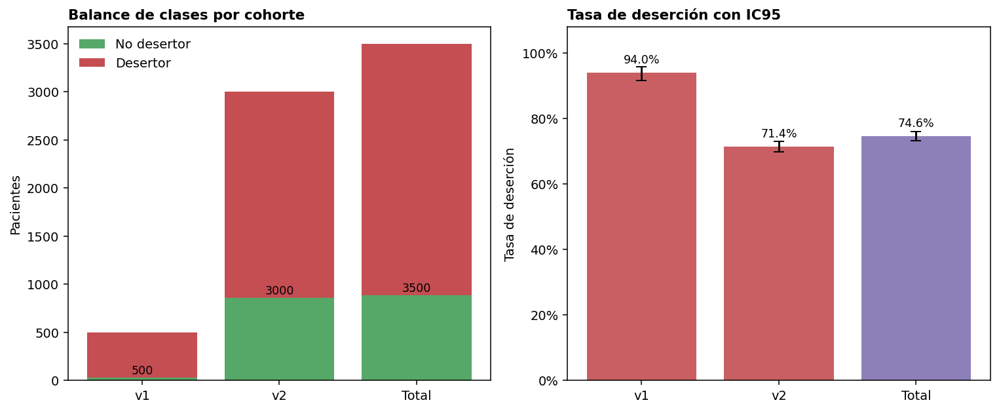

| Cohorte | Pacientes | Desertores | No desertores | Tasa | IC95 |
|---|---|---|---|---|---|
| v1 | 500 | 470 | **30** | 94,0 % | 91,6–95,8 % |
| v2 | 3.000 | 2.142 | 858 | 71,4 % | 69,8–73,0 % |
| Total | 3.500 | 2.612 | 888 | 74,6 % | 73,2–76,0 % |

- **v1 no sirve para modelar:** 30 negativos no permiten una validación cruzada estable ni un holdout con potencia. [R]
- **v2 tiene volumen suficiente**, pero la prevalencia es alta (71,4 %). La accuracy es una métrica engañosa: el dummy ya acierta 71,4 %. [R]
- `Desertor` no distingue abandono de alta, traslado, suspensión médica, remisión o pérdida temporal de seguimiento. [H]
- No hay fecha de abandono ni motivo de cierre. [H]

**Definición operativa pendiente:** “≥ N semanas sin asistir, sin registro de alta, traslado, suspensión médica ni fallecimiento”. N lo define Fisulab. [P]

---

## 4. Efecto cohorte

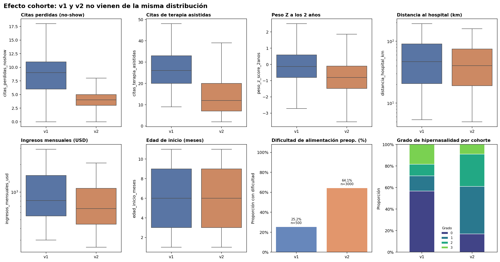

| Variable | v1 media | v2 media | v1 mediana | v2 mediana | SMD |
|---|---|---|---|---|---|
| Citas perdidas (no-show) | 8,60 | 4,04 | 9 | 4 | **1,55** |
| Citas de terapia asistidas | 26,64 | 14,68 | 26 | 12 | **1,35** |
| Dificultad de alimentación preop. | 25,2 % | 64,1 % | 0 | 1 | **−0,85** |
| Peso Z a los 2 años | −0,12 | −0,80 | −0,13 | −0,81 | **0,67** |
| Grado de hipernasalidad | 0,91 | 1,31 | 0 | 1 | −0,39 |
| SES ordinal | 1,21 | 0,83 | 2 | 1 | 0,32 |
| Ingresos mensuales (USD) | 1.195,9 | 990,9 | 806,5 | 660,5 | 0,21 |
| Distancia al hospital (km) | 65,1 | 55,1 | 46,7 | 40,2 | 0,18 |
| Edad de inicio (meses) | 5,91 | 6,09 | 6 | 6 | −0,06 |

**Lectura [R]:** las diferencias no son cosméticas. No-show, terapia, alimentación y peso Z tienen |SMD| ≥ 0,67; son cohortes distintas. Mezclarlas sin control hace que el modelo aprenda “de qué archivo viene el paciente” en lugar del riesgo.

**Regla para los frentes 2 y 4:** v2 para modelado; v1 solo descriptiva o comparación. Nunca un `train` con v1 y `test` con v2, ni viceversa. [Rec]

---

## 5. Fuga de información

### 5.1. No-show

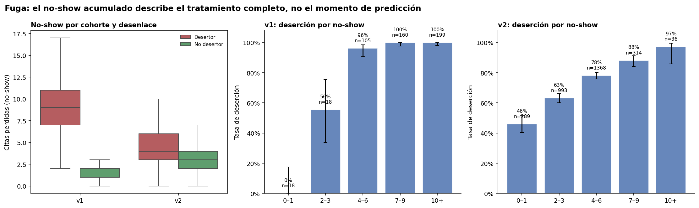

- AUC v1 = **0,991**; AUC v2 = **0,669**. [R]
- En v1, 0–1 no-shows → 0 % de deserción; 4–6 → 96 %; 7–9 → 100 %; 10+ → 100 %. [R]
- En v2 el gradiente es más suave, pero sigue siendo fuerte: 46 % → 63 % → 78 % → 88 % → 97 %. [R]

**Problema:** es un conteo acumulado de todo el tratamiento. El paciente que abandona deja de asistir, así que el no-show sube **porque** abandonó. Usarlo como feature es circular. [R]

### 5.2. Terapia

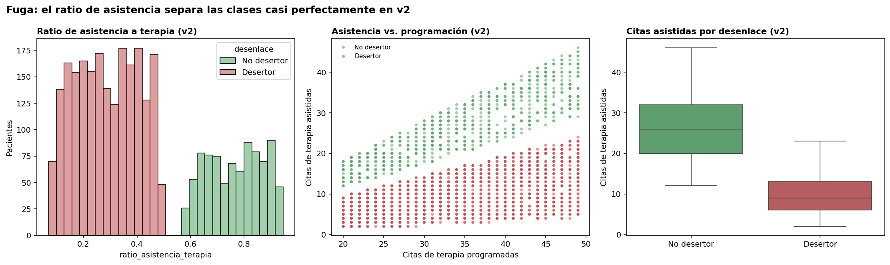

- `ratio_asistencia_terapia`: AUC v1 = 0,538; **AUC v2 = 0,000**. [R]
- `citas_terapia_asistidas`: AUC v1 = 0,509; **AUC v2 = 0,030**. [R]
- En v2, los desertores tienen ratio ≤ 0,49 y los no desertores ≥ 0,58: hay un hueco entre las dos distribuciones. [R]
- El scatter de programadas vs asistidas muestra dos bandas separadas. [R]

**Interpretación [P]:** la etiqueta `Desertor` de v2 parece generada a partir de la asistencia a terapia. Si se confirma, el problema no es “predecir deserción” sino “reconstruir la regla que etiquetó”. Eso invalida el modelado supervisado actual. Es la pregunta más importante para Fisulab.

### 5.3. Otras variables con señal sospechosa

| Variable | AUC v1 | AUC v2 | Estado |
|---|---|---|---|
| `grado_hipernasalidad` | 0,544 | **0,770** | Posible fuga: depende de la terapia recibida |
| `insuficiencia_velofaringea_ivf` | 0,513 | 0,571 | Posible fuga si se diagnostica tarde |
| `peso_z_score_2anos` | 0,546 | 0,495 | Excluir: medido a los 2 años |
| `cirugias_programadas` | 0,668 | 0,490 | Excluir: estimada en v2 |

**Regla [Rec]:** `citas_perdidas_noshow`, `citas_terapia_asistidas`, `ratio_asistencia_terapia`, `citas_asistidas`, `citas_asistidas_imputada`, `cirugias_programadas`, `citas_terapia_programadas` y `peso_z_score_2anos` no entran al modelo. `grado_hipernasalidad` e IVF solo en T1 y con análisis de sensibilidad.

---

## 6. Artefactos del ETL

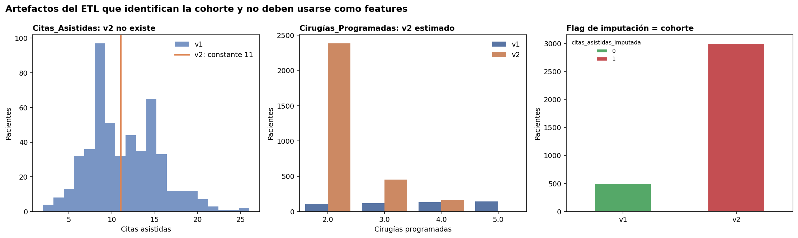

| Cohorte | `citas_asistidas` únicos | Rango | `cirugias_programadas` | `citas_asistidas_imputada=1` |
|---|---|---|---|---|
| v1 | 25 | 2–26 | 2–5 | 0 |
| v2 | **1** | **11–11** | 2–4 (estimadas) | **3.000** |

- `citas_asistidas` es constante 11 en v2. [R]
- `cirugias_programadas` en v2 se estima con `2 + complicaciones`; en v1 viene del archivo. [R]
- `citas_asistidas_imputada` es 1 para todo v2 y 0 para todo v1: es un indicador de cohorte. [R]
- `cohorte` identifica el archivo de origen; los one-hot `fisura_*` son una codificación pre-hecha que debe rehacerse dentro del `Pipeline`, no reutilizarse. [R]

**Consecuencia:** estas columnas no son features válidas en v2. El frente 2 debe eliminarlas del frame de modelado o reconstruirlas con una regla única y documentada. [Rec]

---

## 7. Features T0

Las features T0 son las disponibles al ingreso: tipo de fisura, edad de inicio, distancia, SES, ingresos, apoyo psicológico y dificultad de alimentación preoperatoria.

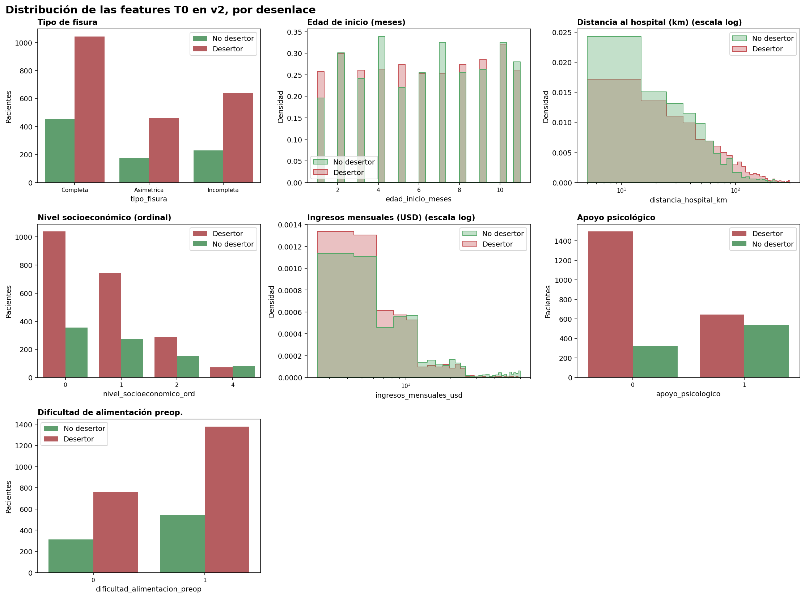

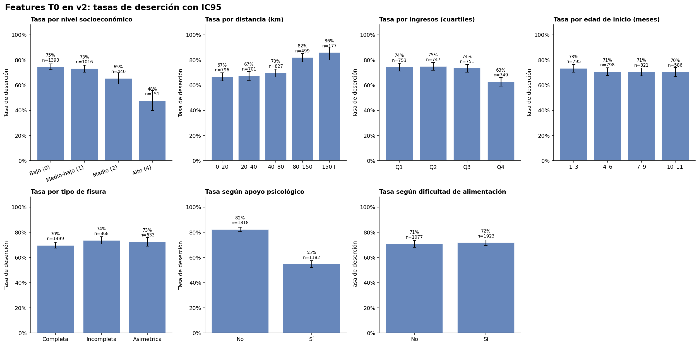

| Feature | Tipo | Resumen v2 | AUC v2 | Lectura |
|---|---|---|---|---|
| `tipo_fisura` | categórica | Completa 1.499 · Incompleta 868 · Asimétrica 633 | — | Tasas 69,6–73,6 %; señal débil |
| `edad_inicio_meses` | continua | mediana 6 [3, 9] | 0,489 | Sin señal; además inconsistente con la cirugía |
| `distancia_hospital_km` | continua | mediana 40,2 [19,1, 75,2] | **0,586** | 0–20 km: 67 %; 150+ km: 86 %; señal plausible |
| `nivel_socioeconomico_ord` | ordinal | 0: 1.393 · 1: 1.016 · 2: 440 · 4: 151 | 0,441 | Gradiente 74,6 % → 47,7 %; escalas no equivalentes |
| `ingresos_mensuales_usd` | continua | mediana 660,5 [445, 1.097] | 0,436 | Q1 74 % vs Q4 63 %; colineal con SES |
| `apoyo_psicologico` | binaria | No 1.818 · Sí 1.182 | 0,338 | 82,3 % vs 54,7 %; posible intervención, no rasgo |
| `dificultad_alimentacion_preop` | binaria | No 1.077 · Sí 1.923 | 0,505 | 70,8 % vs 71,7 %; sin señal; artefacto de cohorte |

**Lectura [R]:**

- La señal T0 más clara es **distancia** y, en menor medida, **SES/ingresos**. [R]
- `apoyo_psicologico` tiene una asociación fuerte, pero si se asigna a pacientes de mayor riesgo es confusión por indicación. No se puede interpretar como factor protector causal. [P]
- `edad_inicio_meses` no muestra señal y además tiene el problema de definición. [R]
- `tipo_fisura` y `dificultad_alimentacion_preop` aportan poco en v2. [R]
- `ingresos` y SES están muy correlacionados (Spearman = 0,926); no conviene usarlos juntos sin regularización o selección. [R]

**Implicación para el frente 4:** el modelo T0 debe evaluarse con estas features, sin imputación fuera del pipeline. Si el AUC queda cerca de 0,5, el problema es la disponibilidad de variables, no el algoritmo. [Rec]

---

## 8. Features T1

T1 añade las edades quirúrgicas, complicaciones, hipoacusia, hipernasalidad e IVF. Es un momento posterior a la palatoplastia; no está disponible al ingreso.

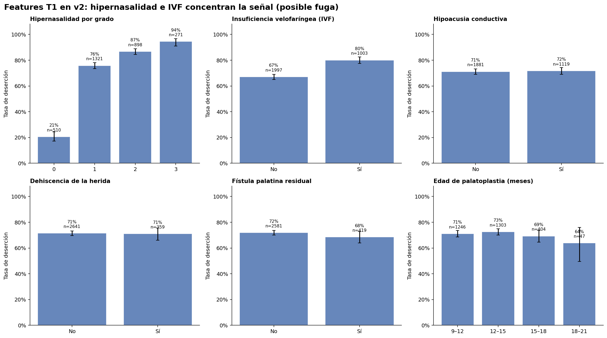

| Feature | Resumen v2 | AUC v2 | Lectura |
|---|---|---|---|
| `edad_queiloplastia_meses` | mediana 4,5 [3,5, 5,5] | 0,487 | Sin señal |
| `edad_palatoplastia_meses` | mediana 12,6 [11,0, 14,1] | 0,492 | Sin señal |
| `dehiscencia_herida_postop` | 359/3.000 (12,0 %) | 0,499 | Sin señal |
| `fistula_palatina_residual` | 419/3.000 (14,0 %) | 0,490 | Sin señal |
| `hipoacusia_conductiva` | 1.119/3.000 (37,3 %) | 0,503 | Sin señal |
| `grado_hipernasalidad` | 0: 510 · 1: 1.321 · 2: 898 · 3: 271 | **0,770** | Gradiente 20,6 % → 94,5 % |
| `insuficiencia_velofaringea_ivf` | 1.003/3.000 (33,4 %) | 0,571 | 67,1 % → 80,1 % |

**Lectura [R + P]:**

- Las complicaciones y la hipoacusia no discriminan en v2. [R]
- **Hipernasalidad e IVF sí**, y mucho. La hipernasalidad pasa de 20,6 % de deserción en grado 0 a 94,5 % en grado 3; el salto de grado 0 a 1 es enorme (20,6 % → 75,9 %). [R]
- Si la hipernasalidad se mide después de la terapia, es una consecuencia del tratamiento y no una predictora. La auditoría ya la marcó como posible fuga; este EDA refuerza la sospecha. [P]
- El frente 4 debe reportar T1 **con y sin** hipernasalidad/IVF. Si el rendimiento se cae al quitarlas, el resultado principal no puede ser T1 con habla. [Rec]

---

## 9. Colinealidad y asociaciones

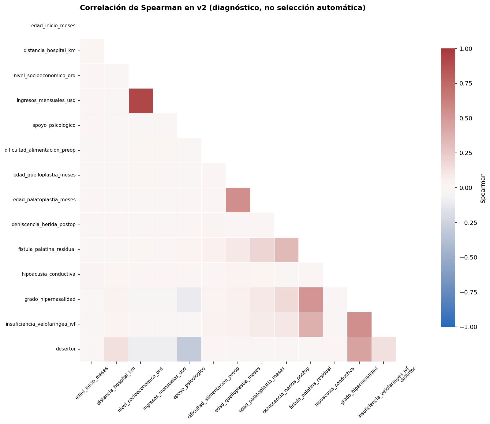

Pares con |Spearman| ≥ 0,30 en v2:

| Par | Spearman | Implicación |
|---|---|---|
| `nivel_socioeconomico_ord` – `ingresos_mensuales_usd` | **0,926** | Redundancia fuerte; elegir uno o regularizar |
| `grado_hipernasalidad` – `insuficiencia_velofaringea_ivf` | 0,546 | Miden dimensiones relacionadas del habla |
| `edad_queiloplastia_meses` – `edad_palatoplastia_meses` | 0,541 | El intervalo es redundante con ambas edades |
| `fistula_palatina_residual` – `grado_hipernasalidad` | 0,512 | Posible cadena clínica; no implica causalidad |
| `grado_hipernasalidad` – `desertor` | 0,450 | Asociación fuerte, pero posible fuga |
| `fistula_palatina_residual` – `insuficiencia_velofaringea_ivf` | 0,377 | Revisar en el frente 4 |
| `dehiscencia_herida_postop` – `fistula_palatina_residual` | 0,331 | Complicaciones correlacionadas |

No se elimina ninguna variable por correlación en este EDA. Se deja la decisión al frente 4, que debe usar validación cruzada y, si aplica, regularización. [Rec]

---

## 10. SES: gradiente real, escalas incompatibles

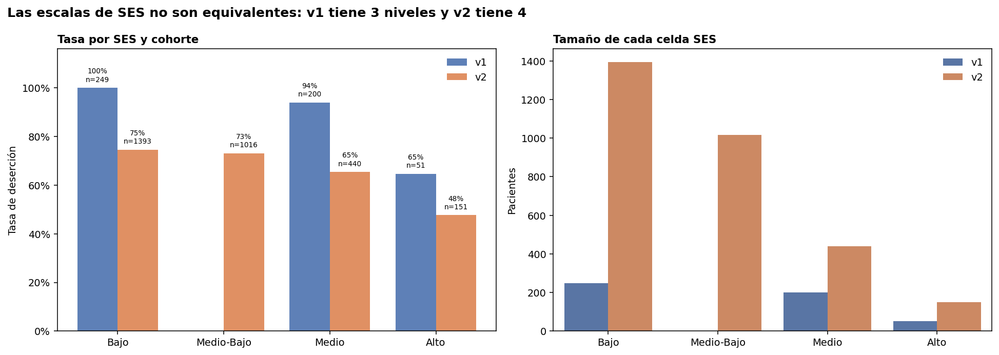

- v1: Bajo 249 (100 % deserción), Medio 200 (94 %), Alto 51 (65 %). No tiene Medio-Bajo. [R]
- v2: Bajo 1.393 (74,6 %), Medio-Bajo 1.016 (73,1 %), Medio 440 (65,5 %), Alto 151 (47,7 %). [R]
- La codificación ordinal actual asigna Bajo = 0, Medio-Bajo = 1, Medio = 2, Alto = 4; no hay 3. [R]

**Lectura [R + P]:**

- El gradiente socioeconómico es consistente en v2: a mayor SES, menor deserción. [R]
- Pero las escalas de v1 y v2 no son equivalentes; no se pueden unir sin armonizar. [H]
- El 100 % de deserción en el estrato Bajo de v1 es un artefacto de la distribución extrema de v1 (94 % de deserción, solo 30 negativos), no un hallazgo clínico. [P]
- SES e ingresos son casi la misma variable (r = 0,926). [R]

---

## 11. Variables ausentes y preguntas para Fisulab

No existen en el dataset:

- Fecha de ingreso y fecha de cierre del tratamiento.
- Fechas de citas: programadas, asistidas, canceladas y no-show.
- Motivo de cierre: abandono, alta, traslado, suspensión médica, remisión.
- Barreras reportadas por la familia.
- Transporte y tiempo de desplazamiento.
- Satisfacción y percepción de progreso.
- Relación con el personal de salud.
- Intención de continuar el tratamiento.
- Motivación, autoeficacia y estado de ánimo.
- Estrés, ansiedad y apoyo familiar.
- Horario y disponibilidad para asistir.

**Preguntas abiertas para Fisulab** (tomadas de `definicion_problema.md`):

1. ¿Qué regla generó `Desertor`? ¿Con cuántas semanas sin asistir?
2. ¿Existen fechas de citas y de cierre con motivo?
3. ¿Con cuánta anticipación necesita el equipo la alerta?
4. ¿Cuándo se asigna el apoyo psicológico y cuándo se miden hipernasalidad e IVF?
5. ¿Cómo se calculó la distancia y por qué el ingreso está en USD?
6. ¿Cuántos pacientes puede acompañar el equipo por semana? Eso define el umbral de “Alto”.

Sin estas respuestas, el proyecto puede producir un modelo técnicamente correcto pero clínicamente incompleto. [Rec]

---

## 12. Implicaciones para los otros frentes

### Frente 2 — ETL sin fuga

- Mover el ETL a `src/infrastructure/data/etl.py` y exponer `build_modeling_frame()` sin imputación cruzada entre cohortes. [Rec]
- Eliminar del frame de modelado: `citas_asistidas`, `citas_asistidas_imputada`, `cirugias_programadas`, `citas_terapia_programadas`, `citas_terapia_asistidas`, `ratio_asistencia_terapia`, `citas_perdidas_noshow`, `peso_z_score_2anos`, `cohorte` y one-hot de fisura. [Rec]
- No imputar antes de dividir train/test; la imputación va dentro del `Pipeline`. [Rec]
- Mantener `select_features(frame, "T0" | "T1")` como contrato único. [Rec]
- Documentar que `citas_asistidas` y `cirugias_programadas` de v2 son inventadas. [Rec]

### Frente 4 — Modelos y evaluación

- Población: v2. Validación cruzada estratificada repetida y holdout del 20 %. [Rec]
- Escenarios: T0; T1 con hipernasalidad/IVF; T1 sin ellas. [Rec]
- Línea base obligatoria: `DummyClassifier` (mayoritaria, prior, estratificado). [Rec]
- Métricas: ROC-AUC, PR-AUC, Brier, calibración, recall a precisión fija y precisión/captura a capacidad fija (top 10/20/30 %). No usar accuracy como métrica principal. [Rec]
- Umbral elegido en validación, nunca en test. [Rec]
- Control de fuga solo como evidencia; se espera AUC ≈ 1 y no se reporta como resultado. [Rec]
- Reportar intervalos de confianza y subgrupos (SES, distancia). [Rec]

### Frente 5 — Interpretabilidad, ética y plan de mejora

- Corregir el README: los datos **no** son 3.500 pacientes reales; son sintéticos. [Rec]
- Documentar las limitaciones: sin fechas, etiqueta ambigua, cohortes incompatibles, posible fuga, ausencia de validación externa. [Rec]
- No presentar el modelo como herramienta de decisión clínica. [Rec]
- Revisar la regla de privacidad: el `.gitignore` actual no excluye `data/` ni `model.joblib`; aunque los datos sean sintéticos, la regla debe quedar implementada antes de usar datos reales. [Rec]

---

## 13. Limitaciones del EDA

- Todo el análisis es sobre datos **sintéticos**. No hay validez clínica externa. [H]
- No hay fechas: no se puede analizar tiempo hasta el abandono, supervivencia ni validación temporal. [H]
- No hay motivo de cierre: no se distingue abandono de alta, traslado o suspensión. [H]
- v1 tiene solo 30 no desertores; sus tasas tienen intervalos amplios y no son comparables con v2. [R]
- El CSV procesado tiene 0 nulos por construcción; la ausencia real de columnas se documenta con los archivos raw y la matriz de disponibilidad. [H]
- El EDA no prueba causalidad. Las asociaciones pueden estar confundidas por cohorte, SES, distancia o por la propia regla de etiquetado. [H]
- No se entrenó ningún modelo en este entregable. Cualquier métrica de desempeño pertenece al frente 4. [H]

---

## 14. Reproducibilidad

```powershell
# DESDE LA RAÍZ DEL PROYECTO
.\.venv\Scripts\python.exe notebooks/03_eda.py
.\.venv\Scripts\python.exe -m pytest -q
```

Salidas:

- `reports/figures/01_balance_clases.png` … `12_ses_cohorte.png`
- `reports/eda_tables.md`
- Este informe: `reports/eda.md`

El script no escribe en `data/`, `src/` ni `model.joblib`, y no requiere API ni red.
